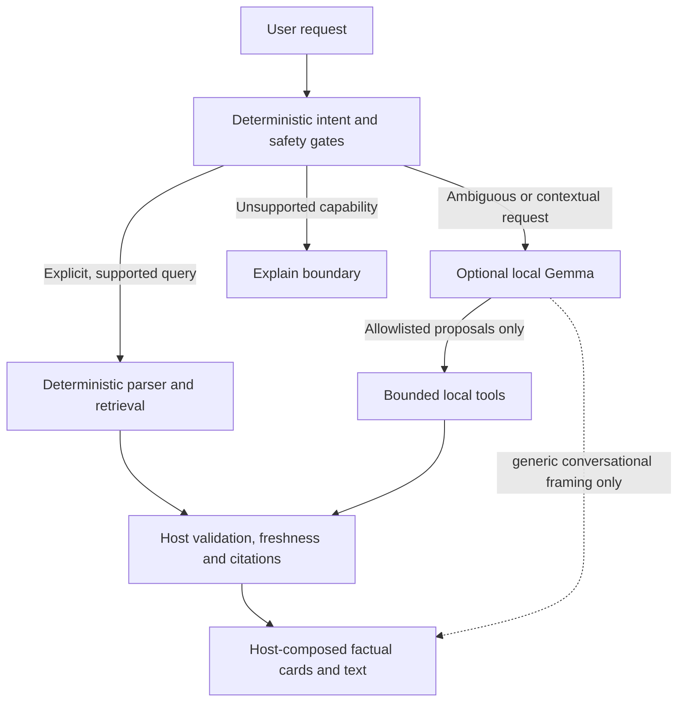

# AI capability matrix

**Scope.** This records the repository behavior inspected on 2026-10-21. It is an implemented capability matrix and model-off acceptance guide; host checks are separate from phone acceptance. The optional installed model is Gemma 4 E2B running locally through LiteRT; no lightweight ML model is present. No measured benefit of ML over existing deterministic logic has been established.

## Current capabilities

| Capability | Deterministic / ML-assisted / LLM-assisted | Existing authoritative path | Direct bypass opportunity | Bounds / limitations |
|---|---|---|---|---|
| Exact places, aliases, and categories | Deterministic | `src/ai/deterministicIntent.ts` and `src/ai/hybridAssistant.ts` route explicit requests through current validated retrieval; directory handles labeled samples | Yes: literal names, categories, simple lookup | Local approved records; bounded lexical matching; no inferred cuisine or live status |
| Approved menu search, tags, branch and price filters | Deterministic | Directory matcher; `src/features/food/assistant.ts`; tool path via `src/ai/tools.ts` and `src/ai/toolExecutor.ts` | Yes: direct dish/menu and price requests | Branch evidence stays attached; unknown prices/tags do not qualify; research is distinct from approved menus |
| Recorded research menus, hours and estimates | Deterministic | `src/features/food/service.ts`, `src/features/food/assistant.ts`; research tools | Yes when request and restaurant are unambiguous | Research/estimated/starting prices are not approved branch facts; hours do not establish open-now or holiday status; rights/source qualifications apply |
| Office/company lookup | Deterministic | `src/features/offices/assistant.ts` and office service | Yes: company, tenant, office and building queries | Approved current operating offices only; research candidates excluded; cited records |
| Price parsing and exact bounds | Deterministic | `src/domain/priceBounds.ts`, `src/domain/money.ts` | Yes: explicit numeric PHP bounds | Integer centavos; under/below are exclusive, between endpoints inclusive; invalid/ambiguous bounds rejected; host applies bounds independently of model proposal |
| Source validation and current fact retrieval | Deterministic | `src/data/retrieval.ts`, `src/data/lexical.ts`, `src/ai/retrieval.ts`, tool executor and answer composer | Yes for factual cards/search | Approval, freshness, source IDs, checksums and citations are checked; model text is not evidence. FTS may contain stale text, but results are rechecked against current supported fields |
| SQLite text and geographic indexes | Deterministic | `src/data/migrations.ts`, `src/data/store.ts`, `src/data/localHealth.ts` | Yes | FTS5 serves indexed search; RTree stores coordinate bounding boxes. Neither is ML or a semantic ranker |
| Route geometry and shortest path | Deterministic | `src/routing/engine.ts`, `src/routing/installed.ts`, `src/routing/progress.ts` | Algorithmically yes; assistant currently blocks route requests | Reviewed offline graph only; current approvals, geometry, access and boundary gates; origin must pass checks and snap within 15 m. Wheelchair routing reports unavailable. Assistant has no route tool and walking directions are unsupported |
| Transit records | Deterministic | `src/data/parser.ts`, `src/data/store.ts` | No useful conversational route answer currently | Approved route/shape/calendar/stop facts are parsed; no live departure or current-service verification |
| Temporary visit-list preview | LLM-assisted for contextual edits; deterministic validation/rendering | `src/ai/tools.ts`, `src/ai/toolExecutor.ts`, `src/ai/itineraryPreview.ts` | No direct mutation parser: contextual edits use Gemma; validation and duration totals stay deterministic | In-memory session draft only; planned visit durations, no travel time/routes, persistence, favorites or commit. Only current approved place IDs |
| Map focus | Deterministic for exact explicit targets; LLM-assisted for contextual references | `focus_map_place` in tool executor; rendered approved place references | Direct exact map/focus intent bypasses Gemma and re-reads current approved identity before action | Reversible focus only; exact approved retrieved place; no raw model coordinates. Current executor restricts action to prior search resolution and, where applicable, the referenced displayed item |
| Ambiguous request interpretation and contextual conversation | LLM-assisted | `src/ai/AgentOrchestrator.ts`, `src/ai/prompt.ts`, bounded allowlisted tools | Keep model for ambiguous language, ordinal references, comparisons/recommendations, and multi-step temporary preview | The selected Qwen model is optional, local, bounded to 2 rounds/4 calls/90 seconds; host owns tool authority; model may propose but cannot expand tool set or authorize writes |
| Factual answer cards | Deterministic presentation; optionally LLM-assisted phrasing | `src/ai/answerComposer.ts`, feature directory payloads and citations | Yes; retain host-owned factual presentation when model is absent | Do not use free prose as a substitute for retrieved facts. Safe free prose should be restricted to general greetings/capability descriptions, while factual replies come from host-composed cards/text with citations |
| Shake navigation | Deterministic signal heuristic (DSP), not ML | `src/ui/shake-detector.ts`, `src/ui/useShakeNavigation.ts` | Already direct | Fixed gravity filtering, magnitude thresholds and deliberate-pattern timing; no learned classifier or claimed measured accuracy |
| Live opening, weather, traffic, reviews, availability | Unavailable | Explicit guards in directory, research assistant and agent | No | No live source integration; report limitation rather than infer |
| Saving/favorites/persistent itinerary writes | Unavailable to assistant tools | Tool allowlist omits commit/write actions; explicit guards | No | Temporary preview must not be described as saved; persistent mutation is outside assistant capability |
| Walking navigation / travel estimates | Unavailable to assistant | Directory and agent route guard; no route tool | No | Graph code exists independently but is not exposed as conversational navigation |

## Implemented hybrid routing

`useAssistantConversation.ts` calls `assistantRuntime.answer`, backed by `runHybridTurn`. The deterministic parser recognizes literal names/aliases, category or explicit lookup, menus/dishes and exact PHP budgets, offices, recorded hours, entrances and explicit map focus. It also handles capability boundaries and simple help without inference. Names in the UI are resolution hints, never factual authority. Approved results use the same strict tool decoder, current retrieval, source revalidation and host answer composer as model proposals. Final card identities are read again; stale approved startup records cannot become fallback facts.

Direct turns permit at most four tool dispatches with a 10-second cancellation deadline and bounded result sets. Source revalidation and final display lookups add bounded reads (up to 12 displayed identities); they are not extra model calls. The existing directory handles explicitly labeled fictional samples/research only when no current tool result qualifies. Recorded research remains separate, obeys exclusions and retains price/branch qualifications. Exact restaurant scope survives the approved-first research check.

Ambiguous qualifiers, contextual/ordinal requests, comparisons and temporary visit-list planning use the selected optional local Qwen model, at most one agent turn (two rounds, four tools, 90 seconds). The model receives bounded allowlisted observations including amounts, branch relationships and price qualifiers; it selects tools instead of recomputing prices or duration totals. Free model prose is restricted to safe general conversation; factual explanation/cards are host-composed from validated tool results. No ungrounded local narrative becomes evidence.

If the model is absent, initializing or unavailable, direct requests continue. Unknown complex requests receive specific supported examples and clarification rather than silently dropping constraints. A failed model turn receives one bounded deterministic clarification fallback, with no inference retry. Denied/canceled turns never replay commands; explicit abort returns no answer. No learned classifier, embeddings, remote inference or extra dependency was added: none has demonstrated measurable value over the existing indexed lookup, exact money arithmetic and deterministic gates.

## Model-off acceptance examples

These scenarios should return deterministic output without model installation. Results depend on the current approved local dataset; empty data must yield a clear empty result, never fabricated records.

| Request | Expected model-off behavior |
|---|---|
| `Find [exact approved place name]` | Exact local place result with approved place identity; no generated substitute |
| `Show coffee` | Local category results from approved directory records |
| `Find [recorded dish] under PHP 500` | Only qualifying recorded approved menu items with PHP price evidence strictly below 500; no match is a truthful empty response |
| `Menu for [recorded restaurant]` | Approved branch menu first; clearly qualified recorded research fallback only when applicable and not excluded |
| `Hours for [recorded research restaurant]` | Recorded schedule and warning that it does not verify current opening or holiday hours |
| `Find [company or tenant] office` | Current approved operating office details and citations, or a clear no-verified-match response |
| `Between PHP 300 and PHP 500 [menu query]` | Exact inclusive centavo bounds; reject malformed, non-PHP or reversed bounds |
| `Is [place] open now?` | Explicitly say live opening status is unavailable; do not infer from recorded hours |
| `How do I walk to [place]?` | Explicitly say walking directions are unavailable; do not leak the graph engine as a promise of navigation |
| `Save [place] to favorites` | Explicitly say saving is unavailable; no write |
| `Preview a visit to [exact approved place]` | Without Gemma, explain preview assistance needs the local model if direct deterministic preview is not implemented; with model, only a temporary in-memory draft and no routes/travel estimates |
| `Focus the map on [exact approved place]` | Resolve current approved identity, then perform reversible focus without inference; do not accept raw user/model coordinates |

## Lightweight ML assessment

No application capability currently justifies a new lightweight ML component. FTS/alias matching, exact budget predicates, graph algorithms, checksum verification and shake thresholds already solve their bounded jobs. Semantic ranking, intent classifiers or learned shake recognition would need a labeled evaluation set and measurable accuracy/latency benefit before adoption. Their status is **ML-assisted candidate, deferred for lack of evidence**, not an implemented or measured feature. The optional Gemma language model is the only learned inference component enabled by this change.

## Evidence and limits

The inspected source includes SQLite FTS5/RTree, exact PHP bounds, approved evidence checks, offline graph routing, optional local Gemma tool use and a threshold shake detector. It contains no enabled lightweight ML classifier/ranker. The matrix does not establish performance improvements or hardware acceptance; host code inspection does not validate behavior on a physical phone.

Host evidence: `scripts/check-regressions.cjs` exercises zero-inference direct requests, exact PHP bounds, current-source map resolution, missing-source rejection, contextual/model-off behavior, one failed-turn fallback and abort/denial isolation. Native phone inference and latency remain owner acceptance work.

## Refinement policy — 2026-10-21

Conversational category requests, including “are there any coffee”, share lexical vocabulary with map search. Ordinary discovery may show sourced recorded candidates, kept distinct from approved records and fictional samples. Verified-only requests exclude them. Near/nearest requests use only a confirmed host origin for local straight-line ordering; no origin is sent to a remote service or used to promise walking navigation. Bounded typo suggestions never trigger focus automatically.

Itemized numeric budget results and visible menu amounts exclude estimates, starting prices and items without branch/source evidence. Original research amounts remain in the source artifact. Restaurant hours exclude mall, delivery and ordering schedules from the primary operating-hours display. Sources remain available through disclosure.

Artifact availability (missing, partial, present, verified), installation pointer state and live runtime readiness are independent. DNS, thermal and OOM failures do not remove verified files. The owner explicitly requested removal of the app thermal veto on 2026-10-23. Android retains its system throttling/shutdown protection; cancellation/idle acknowledgement and initialization ownership fences remain mandatory. Model downloads use bounded foreground retries and preserve range-resumable partial bytes.

### Model choice (v0.5)

Deterministic operation remains the default. Models exposes two selectable Qwen experimental options. Gemma 4 E2B has been withdrawn from selection, downloads and activation at the owner’s request. Its saved active/previous/staged pointers are retired transactionally during recovery, while its downloaded files remain untouched. Only its ID, byte count and checksum remain for decoding legacy pointers. Selecting a Qwen entry does not replace another supported active pointer. Downloads remain explicit, resumable and checksum-verified; activating an existing file never silently downloads it. No weights are bundled or acquired at startup.

Catalog metadata was reviewed on 2026-10-23 against public Hugging Face API LFS records and the pinned model cards. File sizes below are bytes, not measured runtime memory.

| Model | Pinned source revision | Bytes | SHA-256 |
|---|---|---:|---|
| [Qwen3 0.6B dynamic INT4](https://huggingface.co/litert-community/Qwen3-0.6B/tree/e6687177e00897731e7716267eebd4eba0dde7c2) | e6687177e00897731e7716267eebd4eba0dde7c2 | 344671744 | 03e7da1eb1108b50dffaa9bb52cc7bcbad2eb0c66ca990267f480c1e545d2856 |
| [Qwen3 1.7B dynamic INT4](https://huggingface.co/litert-community/Qwen3-1.7B/tree/79bf0667b32ae025b972e5fe555fe72ca6e8816c) | 79bf0667b32ae025b972e5fe555fe72ca6e8816c | 977184032 | 2a72330b504a6596d53a2c00923c57173b10f1b83e6a541213ffec08d1fc5de8 |
| Gemma 4 E2B (withdrawn; historical receipt only) | b3ca0d2f076785a8f4b2219ddbd2bdb99954eae1 | 2588147712 | 181938105e0eefd105961417e8da75903eacda102c4fce9ce90f50b97139a63c |

The withdrawn Gemma row above is historical provenance, not an available model. Qwen metadata is defined independently and does not inherit the withdrawn entry. The Qwen filenames are Qwen3-0.6B_dynamic_wi4b32_afp32.litertlm and Qwen3-1.7B_dynamic_wi4b32_afp32.litertlm. Both are ungated Apache-2.0 artifacts. Redistribution requires preserving license, attribution and applicable notices, noting modifications and respecting the absence of a trademark grant. Weights remain outside the APK. Catalog obligations remain attached to every entry.

The [0.6B pinned card](https://huggingface.co/litert-community/Qwen3-0.6B/blob/e6687177e00897731e7716267eebd4eba0dde7c2/README.md) references the embedded canonical Qwen3 template at a8178d7d and compatibility with LiteRT-LM 0.17.1/current builds. The [1.7B pinned card](https://huggingface.co/litert-community/Qwen3-1.7B/blob/79bf0667b32ae025b972e5fe555fe72ca6e8816c/README.md) states LiteRT-LM 0.18.0 or newer, tested upstream on 0.18.0. The [pinned runtime metadata](https://github.com/google-ai-edge/LiteRT-LM/blob/v0.18.0/models/qwen3/LlmMetadataProto.pbtext) defines Qwen3 templates and native tool parsing. This is source compatibility evidence, not Omni-BGC device acceptance. The runtime owns embedded tokenizer/template handling and parsed tool calls; the app does not install a second language-only runtime or parse arbitrary text into tool execution.

Available Qwen models start with a bounded 2,048-token CPU profile instead of the previous forced 4,096-token runtime allocation. Model artifact capacity remains distinct (4,096 for these Qwen exports). Conversation output remains bounded at 256 tokens, native input at 512 output tokens, with a 120-second generation deadline. Thinking remains disabled. GPU support is retained in the provider but no automatic GPU fallback, NPU claim or unmeasured GPU recommendation is introduced while the map also uses the GPU.

New activation runs bounded text generation, a parsed zero-argument startup tool proposal, a structured tool-result round trip and native release before committing the active pointer. The probe contains no business facts and executes no app tool. A failed probe retains both the verified candidate and previous active model. Existing supported Qwen active models still reverify and reload through their existing recovery path; withdrawn Gemma pointers cannot load or reactivate. An existing verified Qwen file can be recovered as staged after legacy pointer retirement, without automatic inference or activation. Startup probes do not establish broad tool quality, language quality or target-device acceptance. The exact older 0.6B export requires the checksum-bound tool-role text compatibility path described below; actual phone activation passed after that fix. An incompatible export still fails safely and remains downloaded.

### Device activation and system thermal policy (2026-10-23)

The owner explicitly replaced the earlier severe-status app gate with Android-managed
thermal behavior. The app no longer vetoes initialize/generate or cancels inference from
PowerManager status; it retains raw telemetry. No Android thermal override or system
protection was changed. Explicit cancellation, deadlines, epochs, native idle/lease,
release fences and checksum verification remain intact.

On the authorized POCO2311DRK48G/Android16, Qwen0.6 initially passed native text and tool
proposal checks but failed the fresh tool-result nonce. Its exact export template renders
only text content parts. For only that verified SHA, the native codec now preserves the
named structured ToolResponse and adds canonical validated JSON text in the same TOOL
role. Qwen1.7 remains unchanged; allowlist/pending-call/role/JSON validation and the nonce
probe are unchanged. The real LiteRT0.18 SDK codec regression passes. Actual phone
activation then passed all three stages and displayed Ready to chat. A normal native
chat turn also completed. This is evidence of startup/generation and tool round-trip,
not broad bilingual/model-quality or sustained-performance acceptance.

General conversation now uses the active model; direct source lookups and model-off
fallback remain deterministic. Compound lookup/action requests defer intact to the
model. Final actual query outcomes and remaining limits are in
[the device validation report](device-validation-v050.md). On 2026-10-24 the owner selected Qwen1.7; its download/hash and native text/tool/nonce
activation passed on this phone after making the probe completion request explicit in
the user message. Its tool response now carries token data only. The embedded1.7
template already supports structured results and was left unchanged. It is active on
this owner device; no model is promoted to a general recommended default.

## Local tool completion follow-up — 2026-10-24

Qwen3 1.7B proposed valid numeric arguments, but LiteRT-LM 0.18 returns Gson LazilyParsedNumber values. Expo's JNI-to-JSI converter supports boxed Double/Integer/Long/Float, not this Gson subclass, so the number arrived as undefined and the strict tool validator correctly rejected the call. NativeMessages now recursively converts numeric values to finite Double values before emitting a proposal. Exact decimal price strings and IDs remain strings. Invalid native values are reported after the native completion callback, preserving cancellation and close ownership. The cached real-SDK JVM fixture covers lazy numbers, nested duration values, invalid numbers, structured tool transcripts and the existing checksum-specific legacy export path.

Fresh search requests omit unrelated history and previous cards. Explicit ordinal requests retain the original ordinal-to-ID mapping, narrowed to the requested ordinals. Preview directory tools are listed first when enabled, with explicit search/detail guidance; verified-only requests retain their existing approved tool scope. Compact search observations retain at least one exact returned identity when descriptive fields cannot fit. Full source records and final card revalidation remain host-owned. The agent still permits at most two model rounds and four calls; its total deadline is now90seconds because two actual CPU generations exceeded45seconds on the owner phone. Provider initialization/generation/cancel/idle limits remain separate.

One bounded local diagnostic per turn records phase, round, status/error code, input bytes, elapsed time, tool names/statuses and output character count. It contains no prompts, argument values, record IDs or coordinates. It is not shown in chat. Host-only context and native fixtures are not broad model/device acceptance.

At the owner's request, source/freshness controls are hidden in assistant replies, including restored history. Evidence remains in stored payloads and place-detail attribution. Menu history accepts the new bounded optional imageKey/preview fields without changing the SQLite schema or removing existing history. Existing malformed/unknown field rejection remains.

Detail replies use the existing place payload with a bounded focus selector (overview, location, floor, description, category), optional recorded office address, and game-menu presentation. Exact named field requests bypass inference; contextual requests use the existing tools. Only source-backed values reach these fields. Requested floor answers omit unrelated description, while overview replies include description and location. A bounded historical description snapshot preserves the original display. Repeated branch-price/availability boilerplate is hidden from new/restored chat without removing its source metadata.
