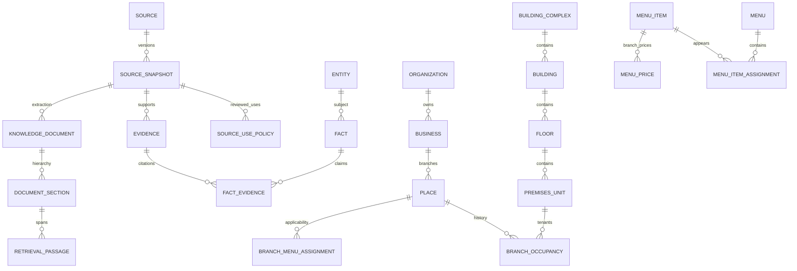

# M4 canonical database and deterministic retrieval

DEC-040 recommendation: adopt PostgreSQL/PostGIS as the canonical production
target, immutable permitted raw snapshots, and versioned SQLite/FTS5/RTree mobile
projections. Preserve the existing SQLite intake/export bridge until the new
target passes live migration, constraint, role, bridge and export tests. Status:
**PROVISIONAL; runtime NOT_RUN; parent ACCEPTS bounded implementation only**. No real facts or
permissions are granted by this architecture.

The inspected M1 schema already provides immutable UUIDs, subtype guards,
evidence/fact histories, exact snapshot/use permissions, spatial and FTS indexes,
and conservative mobile export. M4 intake retains provider mappings and rejects
silent relationship changes. Those interfaces are reusable. Missing capabilities
include a live canonical spatial database, temporal tenant occupancy, normalized
menu sharing/variants/prices, document spans, and a reviewed PostgreSQL-to-SQLite
bridge. Four additive migrations under `packages/database/canonical` propose
those capabilities without editing existing staging/mobile schemas or exporter.

| Candidate | Assessment for this project | Decision |
|---|---|---|
| PostgreSQL/PostGIS plus mobile SQLite | Strong relational editing and indexed spatial predicates; concurrent review and immutable evidence remain in one transactional store. Requires a local/server runtime, backups and operational ownership. | Selected target; validation provisional |
| SQLite throughout | Current portable editing/export works; simple local development and backup. Spatial RTree is bounding-box filtering, requiring separate geometry/topology logic; coordinated multi-reviewer editing needs deliberate ownership. | Retain operational compatibility bridge and mobile |
| DuckDB/Parquet | Efficient analytical scans, archive/coverage summaries and interchange. Transaction/concurrency model differs from a shared transactional review service. | Optional measured analytics later; no new dependency now |
| Separate graph database | Typed relationships and traversals are available, but introduces a second identity, rights, history and backup system. Existing pedestrian graph/A* contract already has an owner. | Rejected for M4; no measured unmet need |
| Dedicated search/vector service | Adds another consistency/publication gate. SQL/SQLite lexical queries suffice for the approved deterministic scope; no semantic benchmark or AI layer is authorized. | Rejected for M4 |

This is a requirement-based engineering inference, **not** a measured throughput
comparison. No canonical server latency, memory, hosting cost, dataset size or
Android performance figure is claimed. PostgreSQL constraints provide relational
integrity; cross-row rules use foreign keys and durable insert guards instead of
cross-table CHECK expressions, following [PostgreSQL constraints guidance](https://www.postgresql.org/docs/current/ddl-constraints.html).
[PostGIS ST_DWithin](https://postgis.net/docs/ST_DWithin.html) uses geographic
metres and available spatial indexes; canonical point queries use GiST geography
indexes. [SQLite FTS5](https://sqlite.org/fts5.html) and
[RTree](https://sqlite.org/rtree.html) remain the offline lexical/bounding-box
tools. [DuckDB concurrency](https://duckdb.org/docs/current/connect/concurrency)
and [Parquet predicate pushdown](https://duckdb.org/docs/extensions/parquet)
support its analytical role; [Neo4j's own model](https://neo4j.com/docs/getting-started/graph-database/)
documents its separate node/relationship store.

Engine licensing and source licensing are separate: PostgreSQL has its own
[permissive license](https://www.postgresql.org/about/licence/), SQLite is
[public domain](https://www.sqlite.org/copyright.html), DuckDB uses
[MIT](https://github.com/duckdb/duckdb/blob/main/LICENSE), and PostGIS distribution
must respect its [GPL licensing/install guidance](https://postgis.net/docs/manual-3.5/postgis_installation.html).
None grants merchant text, media or transit reuse rights. No commercial service
was purchased or required. Physical table separation does not decide ODbL
derivative/collective-database obligations.

Mandatory logical names map to implemented tables/views in
`docs/evaluations/m4/comprehensive/architecture/data-dictionary.json`. `place`
retains the physical branch UUID; `business_branch` is a classified view of it.
Legacy `business` identity is retained with explicit unknown/brand/organization
classification, never automatically interpreted as a brand. `floor`,
`operating_hours`, `holiday_exception`, `route_node` and `route_edge` map to the
existing named contracts. Saved favorites, itineraries and device settings stay
outside replaceable content databases.

Each entity UUID/kind is immutable and cannot be deleted/recycled. External
provider references persist, independent of names/coordinates. Snapshot bytes
and evidence lineage are immutable; facts append versions instead of rewriting
values. `fact_history` only supersedes the same subject/property. Review changes,
source revocation and permission changes retain append-only audit before/after
records with `omni.actor`; this records an actor assertion, **not authentication
or an authorization system**. Role provisioning and authenticated reviewer APIs
remain unimplemented. All ordinary PUBLIC schema/table/function access is
revoked; no production app/publication-reader grants are created.

Building, wing, floor and unit use parent foreign keys. Temporal occupancy is
separate from the branch, permitting moves and changed tenants while keeping
identities stable. Conflicting overlapping candidate occupancy is retained for
review, not automatically merged or excluded by a guessed uniqueness rule.
Menus apply to explicit branch assignments; reusable item identities have menu
membership and branch/menu/variant price facts. Currency and integer minor units
are explicit; null is unknown, never zero. Relationship fact subject/value/period
bindings cover occupancy, entrances, menu applicability, item membership, price,
category, document links and geographic claims. Remaining operational schedules,
hours and amenities currently bind fact subject/property without exhaustive
typed JSON payload validators; they have no live typed publication endpoints.

Points and geometry exchange use EPSG:4326, longitude then latitude. Geometry
claims preserve source CRS and transformation description, not an assumption
that changing SRID transformed coordinates. Exact fact/geometry matching, valid
2D geometry and world ranges are checked. This cannot detect every correctly
ranged coordinate labelled with the wrong CRS or a false transformation; source
CRS evidence and regional QA remain required. Multiple candidate point facts can
coexist. Nearby results require a verified entity location, an approved current
coordinate and eligible evidence; they cannot approve an entrance or route.
Route stop/node claims bind their own entity; edge LineStrings bind the edge and
exact node endpoints. Topology stays candidate until separate access/crossing,
level, safety and field review. No canonical route solver or safe graph export is
implemented by these migrations.

Publication functions require explicit UTC time, approved entity/fact/evidence/
snapshot, current validity, source APPROVED, exact snapshot/hash/use policy,
positive redistribution/offline rights, attribution, reviewer/date, satisfied
obligations, human rights review, parent engineering review and explicit user
distribution authorization. Source revocation immediately denies eligibility.
Public OSMF raster sources are categorically denied. Menu identities/names and
all menu facts require menu_text permission. Contradictory approved evidence,
unresolved review queues and differing current singleton claims deny facts.
Price conflicts are scoped by branch/menu/variant; categories/aliases and other
enumerated repeated properties permit multiple values.

`approved_facts`, `get_source_evidence`, `find_nearby_places` and lexical
`relevant_knowledge_passages` are proposed trusted-exporter functions, **not a
complete mobile pack approval**. Typed domain tables and review-only views must
never be exposed directly to the app. Export must rehash retained raw/evidence
files, re-evaluate current rights, validate relationship chains and produce the
existing reviewed rights/update manifest. That PostgreSQL bridge is **NOT
IMPLEMENTED**. Current export remains existing SQLite machinery. Tables/audit
support historical reconstruction, but historical source-rights replay is not
an implemented API; `approved_facts(at)` uses current review/rights and does not
claim a historical permission grant.

Document ingestion requires prior authorization to retain extracted text. A
private immutable full extraction has its UTF-8 SHA256, length, tool version,
snapshot and locator. Sections preserve parents and offsets; passage IDs bind
document/section/span/hash. Offsets are Unicode code points, not UTF-8 bytes or
UTF-16 indices. SQL checks exact source substring, bounds, evidence snapshot and
body hash. The Python splitter preserves parent introductions/conclusions,
prefers child sections and splits oversized spans at paragraph/sentence/space
boundaries. Trusted acquisition must still prove extraction corresponds to the
retained raw snapshot; SQL cannot authenticate arbitrary privileged imports.
Passage retrieval requires document_text rights, approved document/passage,
eligible source evidence and current dates; filtered entity links require their
own approved exact document-link fact. Citations retain passage, document,
section, offsets, evidence and snapshot identities. No text has been collected.

Future AI should call approved deterministic operations and receive unknown,
stale/unsupported status plus citations; it must not write canonical facts.
Structured branch/menu/price/dietary/spatial/transit filters belong in SQL.
Authorized longer reference passages belong in document retrieval. Exact/NFC
alias handling precedes lexical query; current SQLite unicode61 tokenization
needs explicit multilingual/CJK and accent evaluation rather than an assumed
universal stemmer. Canonical lexical search uses PostgreSQL's documented
[full-text search](https://www.postgresql.org/docs/current/textsearch.html)
with the `simple` configuration. Geographic filtering precedes any future
ranking. [pgvector](https://github.com/pgvector/pgvector) is only a researched
future option; no vector column, extension, embeddings, model or agent is added.
Fuzzy matching is review assistance and must not merge same-name branches.
Representative evaluation cases must include quoted aliases, CJK, unknown
ingredients, branch-specific menus, expired prices, revoked text rights and
source-backed route uncertainty; runtime retrieval benchmarks remain NOT_RUN.

Portable tests: 15 PASS including migration hash/safety contracts, document
coverage/Unicode/hash/determinism and PostgreSQL grammar parsing. PostgreSQL/
PostGIS initialization, repeated apply, runtime adversaries, query plans,
backup/restore, roles, bridge parity and real/device data are **NOT_RUN/BLOCKED**.
See the dated lane journal/evidence and setup README; parent must independently
review before ACCEPT. The existing operational SQLite path can proceed while
this additional target remains provisional.
