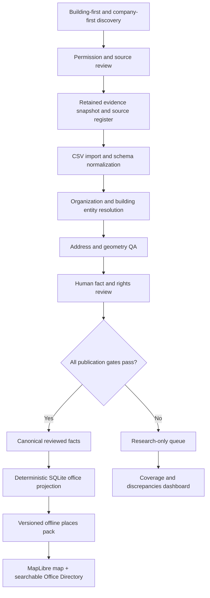

# Omni-BGC — Company Office Directory: Full Implementation Plan

**Document version:** 1.0  
**Prepared:** 2026-10-14 (Asia/Manila)  
**Status:** PROPOSED — planning/research only; no repository modifications or publication authorized  
**Repository:** https://github.com/supertaku/omni-bgc  
**Research input:** `BGC_Company_Offices_Directory_EXPANDED_2026-10-14.csv` / `.xlsx`  
**Target platform:** existing offline-first Expo/React Native Android app, iOS-compatible  
**Primary objective:** A scalable, evidence-backed, source-compliant company-office directory for BGC and its agreed vicinity, with an offline read-only app experience and sustainable discovery/refresh workflow.

## 1. Executive decision

Implement the directory as a **new reviewed office-location domain within Omni-BGC**, not as an unverified JSON list added directly to the public map. Keep the complete researched inventory in a local, auditable candidate pipeline; publish only factual, geographically fit, rights-cleared records through the existing versioned SQLite content-pack process. First deliver a complete audit and research-review experience, then a deliberately bounded public app pilot.

A company, legal entity/brand, office occupancy, building, floor, geographic point and entrance are **different entities**. One company may occupy multiple buildings/floors; one building may contain many companies; one company can move while keeping a stable identity. A building centroid is suitable for approximate display **only when labeled**, never as a claimed office-door location or walking-route destination.

### Non-negotiables
- Preserve `AGENTS.md`, `docs/DECISION_JOURNAL.md`, V2.1 accepted map/Assistant UI, optional location permission and offline-first behavior.
- No remote inference, LLM-led publication, background network dependency, unapproved scraping, fabricated coordinates, inferred entrances or walking navigation.
- Do not silently import spreadsheet statuses as source-rights clearance or canonical approvals.
- All changes to schema/IDs, publication and main integration require parent review; maintain branch, tests, evidence and rollback.
- Keep existing High Street service-area claim separate from BGC/McKinley directory research; expanding coverage requires a reviewed polygon and pack.

## 2. Inputs, audit and known limitations

The source CSV contains **179 office-location records**, **173 distinct company-name strings**, **81 distinct building/complex labels** and **108 distinct source URLs**. It has 52 `NEW — broader audit` records relative to v1. Evidence-strength distribution: High 62, Medium 98, Low 10, Review 9. Geographic buckets: BGC Core 129; Uptown Bonifacio 21; McKinley Hill 19; McKinley West 8; BGC fringe 2.

Data gaps identified directly in the CSV:
- No latitude/longitude, polygon, geometry source or location-accuracy data.
- 43 records have no floor/suite; 11 are district-only; 32 are building-only (136 have building + floor/suite strings).
- Different company rows may share the same actual building; display labels, aliases and historical building names are not normalized. Never assume 81 labels equal 81 verified physical properties.
- A source URL may be official but not substantiate a specific office: two Accenture records link to `https://www.accenture.com/en/about/location?loc=Ireland`.
- Research-date is not source-publication date, current occupancy proof, nor offline redistribution permission.
- Some addresses may represent a registration, mail/virtual office, vacancy/job post, old lease or employer profile rather than current active occupancy.

**Required regression examples:** Infor (Asian Century Center + Seven/NEO), P&G (Net Park/Seven/NEO), Thinking Machines (Twenty-Four Seven McKinley), DigiPlus (Ecoprime Building), HCLTech (several distinct sites), SAP, AWS and Lazada. These are test *leads*, not automatic publication grants. The research directory is a candidate evidence base; no public-ready record count is asserted.

## 3. Scope and boundaries

### Geographic tiers
1. **Core:** Bonifacio Global City proper, including Uptown Bonifacio as a neighborhood within the BGC-oriented directory taxonomy.
2. **Adjacent districts:** McKinley Hill and McKinley West, explicitly labeled and not silently treated as official BGC territory.
3. **Fringe/vicinity:** separately named adjacent corridors/office clusters when within a **versioned, human-approved study-area polygon** or a documented inclusion exception; do not use a broad Taguig/Makati search result as sufficient evidence.

Use `data/manifests/service-area-v1.json` **only** for the historical High Street pilot. Create `data/manifests/office-research-area-v1.geojson` plus README documenting the *project-defined* search boundary, zone definitions, sources, decisions and polygon version. Research visibility may exceed mobile-map pack coverage. A directory result outside the licensed offline map must explicitly say that map coverage is unavailable; do not zoom to nonexistent tiles.

### Included
Publicly documented corporate/operating headquarters, satellite offices, technology centers, BPO/delivery centers, bank corporate offices, professional-services offices, government-facing corporate offices, and tenant office suites. Document virtual/registered-only locations but filter them from the default **operating offices** view until accurately classified.

### Excluded from automatic company-office counts
Retail storefronts with no independent corporate office, PO boxes, temporary recruitment-event locations, coworking membership without evidence of tenant occupancy, stale historical addresses and unsubstantiated district-only workplace claims. These may stay as research leads or a separate class.

### Out of scope for initial release
Employee/contact lists; individual staff; personnel security; unapproved tenant photos/logos; private building access routes; emergency claims; office operating hours inferred from staff shifts; online map/geocoding required by the app; AI-generated location facts; web-hosted back office; fully general automated internet crawler.

## 4. Product contract and user journeys

**Researcher:** Import a deterministic CSV snapshot; inspect all 179 candidates; find missing buildings and address discrepancies; attach per-fact evidence; suggest/review duplicate aliases; approve sources and occupancy separately; generate candidate/approved/rejected and coverage dashboards.

**App user:** With airplane mode enabled, choose **Offices** from the existing map categories or search. Search by `P&G`, `Procter and Gamble`, `Infor`, industry, office building or subdistrict. Find separate sites of the same company; see building, floor when supported, complete address, `verified on` date, sources, confidence/freshness and approximate map location when available; save/share a place where approved. Never show an invented entrance or route.

**Data steward:** Diff a new source snapshot against previous facts. Mark a company moved, office closed, location uncertain or updated. Preserve history and stable IDs. Rebuild a signed/hash-verified approved offline pack. Roll back on schema/quality/release failure without clearing user favorites.

**Required empty/degraded states:** No approved offices yet; outside-map-coverage; company known but building unverified; building verified but floor unknown; source stale; candidate excluded from public release; content pack unavailable; last-known approved pack available offline.

## 5. System architecture



**Operational choice:** Extend current M1 SQLite staging/M4 place-intake and pack bridge for the first functional release. The proposed PostgreSQL/PostGIS canonical migration in `packages/database/canonical/` is **provisional and not runtime-proven**; do not make production deployment of a database server a prerequisite. Later migration to PostgreSQL is conditional on tested migration, rights functions, APIs and review operations. No new cloud backend required for MVP.

## 6. Canonical data model and identity

Reuse existing `entity`, `source`, `source_snapshot`, `source_use_policy`, `evidence`, `fact`, `fact_evidence`, `organization`, `business`, `place`, `building`, `floor`, `premises_unit`, `branch_occupancy` and `point_geometry` *where actually available and accepted*; bridge provisional Postgres constructs through an explicitly reviewed additive staging/mobile contract. Never assume migration files mean the production database already runs.

### Logical entities
- `Organization`: stable legal/company identity, display name, aliases, parent/group if sourced. Public brand and legal employer can be distinct; do not automatically collapse e.g. affiliates.
- `OfficeLocation`: stable physical occupancy/facility identity connected to organization and building, including site role (`headquarters`, `operating`, `delivery_center`, `satellite`, `registered_only`, `virtual_only`, `unknown`). One organization → many office locations.
- `Building`: canonical physical property/complex, alternate historic names, zone geometry, location quality; one building → many office locations and entrances.
- `FloorUnit`: optional floor/suite relationship; absence is `null`, **not** ground floor.
- `Occupancy`: org/office/building/floor association with `valid_from`, `valid_to`, `observed_at` and cited evidence. Office moves create history, not updates that erase the past.
- `Fact`: property-level claim, evidence links, freshness/review, contradictions, source-use rights. A company-name fact and building-address fact may have different confidence.
- `GeoLocation`: building footprint point, field-observed entrance, building centroid, or unknown, with source and precision; do not store inferred entrance in the same field as map display coordinate.

### Proposed normalized research row (illustrative, not direct production contract)
```json
{
  "candidate_id": "research:offices:v2:source-row-0001",
  "source_row_id": "v2-0001",
  "organization_id": null,
  "office_location_id": null,
  "company_name_raw": "Example Corporation",
  "company_aliases": [],
  "district": "BGC Core",
  "building_name_raw": "Example Tower",
  "building_id": null,
  "floor_raw": "12F",
  "suite_raw": null,
  "street_address_raw": "32nd Street",
  "presence_type": "unknown",
  "location_kind": "unknown",
  "display_longitude": null,
  "display_latitude": null,
  "publication_state": "research_only",
  "source_ids": [],
  "evidence_ids": [],
  "review_required": true
}
```
A deterministic row key from snapshot ID + row ordinal is permitted **only for provisional import references**. Allocate immutable canonical UUIDs transactionally through the existing provider/external-reference mapping when identities are approved. Never generate canonical IDs from names, floors or coordinates. Parent approval required before any schema changes.

### Candidate-to-published separation
- **Research-only:** May be searched within local researcher dashboard, but must never be silently inserted into `browsingPlaces` as an approved entity.
- **Provisional with location:** Not automatically publishable; any preview must be explicit and internally controlled.
- **Published:** All current factual, geographic, source-rights and parent publication gates pass. App record gets `status=approved` only from the accepted exporter.
- **Stale/historical:** Retain evidence/history; remove from default operating-office results and invalidate expired current facts.

## 7. Discovery strategy — broader than a company-name list

Use **four mutually reinforcing sweeps** with a shared evidence register. Discovery is not approval.

### A. Building-first sweep (primary new method)
Inventory canonical BGC/Uptown/McKinley office buildings, complexes and known old/new names. For each property, find permitted management/landlord tenant directories, official building sites, tenant contact pages, office lease/occupancy documents and legally usable field observations. Record tenant leads with building and floor. Assess coverage per building: `unsearched`, `searched_no_public_list`, `partial`, `multi_source`, `field_checked`. This catches companies never mentioned in generic “top BGC companies” results.

### B. Industry-first sweep
Independently compile companies by BPO/IT-BPM, software/SaaS, cloud, telecom, finance, fintech, insurance, banks, consulting/legal/accounting, shared services, logistics/aviation, utilities, retail headquarters, healthcare administration, real estate, education and gaming/entertainment. Cross-check each candidate against official contact/location pages and corporate records. Keep separate leads for a branch, headquarters and satellite offices.

### C. Evidence-first sweep
Prioritize (in order): company-published physical office address or current report; current regulatory disclosure (PSE EDGE, appropriate SEC/public corporate filings, regulated-firm directories); landlord/operator tenant directory; recent company recruitment address **as corroboration**; association directories; company-managed social profiles; third-party aggregators. Record **what exact claim a page supports**, not simply that a URL contains the company name.

### D. Gap and contradiction sweep
For every building and target industry, explicitly query `missing`, `unverified`, `old building name`, `multiple offices`, `registered vs operating`, `address conflict`, `building verified but floor not confirmed`. Include direct targeted probes for Infor, P&G, Thinking Machines and DigiPlus in every regression suite. Maintain a curated *must-check company* queue but do not rely on memory alone.

### Search/collection policy
Do not automate arbitrary scraping. Check robots, terms, public API limits and retention/export rights **before access or retention**; prefer licensed permitted exports or human-authored source citations. Public job boards and social sites can serve as leads, but not as permission to redistribute whole pages or private employee records. LLMs may assist query generation, normalization suggestions and candidate matching, but cannot fabricate evidence or auto-approve presence.

### Coverage denominator
Use independently gathered building inventories/tenant registries to estimate ascertainable coverage only when a defensible denominator exists. Publish counts (source leads, buildings visited in research, verified active offices) rather than unsupported “95% of BGC companies” claims. Define recall samples through blind search audits and seeded known-companies set.

## 8. Source and fact verification

Required retained source fields: `source_id`, owner/authority, canonical URL/document ID, source-kind, terms/licence, rights by use (`internal_retain`, `transform`, `redistribute_offline`, `images`, `geography`), evidence/document/section locator, original publication date where known, observed and fetched UTC timestamps, raw SHA256 for permitted snapshots, access constraints, reviewer, reviewed UTC, expiry/recheck date, contradiction flags.

For each office claim: `company_identifier`, `building_identifier`, `floor/units` if supported, `presence_classification`, `valid_from/to` (if substantiated), `verified_at`, `verification_method`, `source_evidence_id`, `confidence_reason` and `review_state`.

Verification is a **hard gate**, not just a weighted score:
1. **Identity:** organization and distinct office location resolved; no accidental affiliate or coworking duplicate.
2. **Presence:** credible current evidence supports physical occupancy/registration classification; historical reports cannot silently be current.
3. **Address:** building/site and any floor claims are evidence-supported; conflicting addresses stay review-required.
4. **Geography:** coordinate is linked to verified physical building; address/point within approved research/service zone; no `(0,0)` or lat/lon reversal.
5. **Rights:** allowed exact data use and offline distribution with required attributions and expiry/revocation checks.
6. **Human + parent approval:** reviewed by named accountable reviewers and explicitly authorized for release.

The existing `High / Medium / Low / Review` spreadsheet **evidence-strength tags are triage priorities**, not outcomes of these six gates. Do not infer current office status from a strong source type alone. Separate `source_published_at` from `research_date`. Set missing values to `unknown`/`null`, not today's date.

## 9. Geolocation implementation

**Build the building registry before geocoding companies.** One physical building geometry serves all its approved tenants. Link by reviewed canonical building IDs, retaining aliases e.g. Seven/NEO / formerly Net Park only after property identity verification.

Prefer existing rights-cleared building polygons from Omni-BGC GIS, verified landlord-provided position or field survey; otherwise use a source-compliant, manually reviewed geocoding candidate. Store candidate coordinates separate from published coordinates. Resolve street alias, tower, complex wing and multiple similarly named buildings. Geometry uses WGS84 EPSG:4326 in GeoJSON `[longitude, latitude]` order. `centroid` is approximate display location only; entrance requires distinct field-grounded access evidence.

**No public Nominatim bulk-crawler:** official hosted API forbids systematic POI extraction, disallows autocomplete, and limits use severely (absolute maximum 1 request/s; recurring bulk restricted to 4/min and strict caching). Prefer previously approved data, manual QA, a provider whose terms permit bulk and offline reuse, or an explicitly approved self-hosted geocoder. Do not use Google geocoding outputs with non-Google maps or permanent offline caches without confirming current contract permissions.

At mobile-map load, only approved features with approved location geometry are added. District-only records remain text/search results (if separately publication-cleared) without a pin; records outside the current map pack show a coverage notice rather than an empty map. Never suggest a building centroid is a public office entrance.

## 10. Data pipeline: deterministic, reversible and testable

### Stage 0 — snapshot and baseline
Store original input file unmodified with SHA256 and manifest in **ignored private workspace** `data/generated/offices/input/`. Do not commit unreviewed source datasets. Generate row-count, source-count, district distribution, missing fields, conflicting URLs, property aliases and duplicate-review report. Introduce versioned `data/research/offices/` code/manifests without asserting public release rights.

### Stage 1 — parser/normalizer
Add `pipelines/etl/offices/import_directory.py` (proposed path). Parse UTF-8 BOM CSV, validate exact 19-column v2 header, trim whitespace, normalize Unicode, normalize district via versioned code table, parse floor ranges without inventing floor levels, retain full raw strings and row ID. Malformed URLs/date/address and ambiguous records go into reject/review files, not silently dropped. Output a sorted deterministic internal JSON/SQLite candidate dataset and `import-report.json`.

### Stage 2 — research/evidence
Extend `pipelines/etl/research/` and the source register to store one or more claim-specific source references per office; the current CSV only has one URL per row. Use `capture.py` for permitted local exports, not website crawling. Add source relevance tests and explicit no-evidence cases. Recheck official contacts and regulatory filings. No raw copy retained if site terms do not permit it.

### Stage 3 — identity and building match
Add reviewed building alias map and company identity crosswalk. Candidate generator may suggest exact-address/name/floor matches, but contradictory floors, legal subsidiaries, shared-service operators, office moves and multiple buildings create human review queues. Preserve raw and normalized values separately. Canonical office-location IDs allocated transactionally through existing external-reference logic.

### Stage 4 — geometry and occupancy
Join to approved building registry, perform zone/precision QA, record `location_kind` (building_polygon_anchor / verified_site_point / unknown), occupancy roles and history. No inferred entrances. Introduce typed office occupancy only through additive, backward-compatible schema migrations after architecture review.

### Stage 5 — promotion and publication
Adapt the current place-intake flow to handle office facts, which still require supported property/relationship binding and positive exact-snapshot permissions. Review dashboard shows `research`, `candidate`, `blocked`, `approved`, `stale`, `historical`, rights conflict and geo issue. Generate mobile read projection from **approved** facts only. Do not weaken `export_mobile.py` checks or use the unreviewed `apps/mobile/assets/generated/directory/places.json` research-preview path as a back door.

### Stage 6 — pack/release
Emit deterministic `office-directory` projection inside existing versioned **places content pack** (preferred unless version sizing/profile motivates separate pack), with schema version, producer version, data range, source/rights manifest, SHA256, record/diff stats, expiry rules and rollback compatibility. Keep saved places outside replaceable packs. Test cold install, upgrades, interruption recovery, downgrade and rejected/corrupt pack.

### Stage 7 — periodic refresh
Revalidate high-volatility records more frequently than stable buildings: initial proposed cadence quarterly for reviewed operating-office addresses, monthly for conflicting/historical records, on official move/closure notices immediately. These are **review queues** rather than unattended external web scraping jobs. Every changed fact produces an immutable version and publication diff. Expired records do not retain a misleading `current` label.

## 11. Mobile app implementation

Reuse:
- `apps/mobile/src/app/Application.tsx` (composition), `useExplorerNavigation.ts` (panel state)
- `apps/mobile/src/features/explore/directory.ts`, `ExplorePanels.tsx`, `PlaceDetails.tsx`, `MapChrome.tsx`
- `apps/mobile/src/data/parser.ts`, `store.ts`, `retrieval.ts`, `queries.ts`
- `apps/mobile/src/map/MapCanvas.tsx` and native MapLibre layers
- existing `apps/mobile/src/contracts.ts` and `apps/mobile/src/updates` pack lifecycle.

Changes, behind an opt-in/feature flag until accepted:
1. **Category:** Add human-readable `Offices` with internal versioned `office` taxonomy (do not overload `Shops`). Surface in compact top chips only if UX/accessibility review approves; otherwise expose from `More`.
2. **Search:** Search company name, aliases, building, industry and district. Disambiguate companies with multiple locations; distinguish company office vs retail branch. Retain the existing deterministic search behavior and current-fact filtering. Use SQLite FTS5 for indexed lexica once projections and benchmarks justify it, with controlled token sanitization.
3. **Details:** Company, industry, office type, building/complex, floor/suite (or unknown), address, subdistrict, reviewed presence date, source citation(s), location-precision warning. Add `Report incorrect office` UI only when there is a suitable reviewed feedback path; otherwise route to a non-sensitive documented feedback channel, with no automatic content edits.
4. **Map:** Approved building/site markers only; multiple office entities can point to one building without producing dozens of stacked pins. Tap building cluster to reveal tenant office list. Do not break current map label and touch interactions or obscure landmarks.
5. **Outside geographic coverage:** When current offline High Street map has no approved tiles/geometry, show directory detail and `Not available in the current offline map area`; **do not** silently zoom to unsupported districts.
6. **Saved:** Stable canonical office location IDs; preserve favorites across renamed/relocated listings. Treat old saved IDs as unavailable-with-history if retired, not as a new unrelated office.
7. **Assistant:** If the deterministic Assistant is extended, its office answers may only use the **same approved, fresh mobile facts** and must disclose exact sources. No unapproved AI model selection or speculation.
8. **Accessibility/privacy:** minimum 44–48 px target, dynamic/large text, TalkBack labels, no employee personal data, no GPS requirement, all searches local, permission-independent manual browsing.

**Contract note:** Existing `Place` has only `id/name/category/coordinate/building/floor/aliases/entrances/citations/status/menus`. Extend via a narrowly scoped `OfficeDetails` projection keyed by `placeId` or reviewed optional typed fields; do not insert `industry` strings into menu/cuisine fields or alter existing retail/menu semantics.

## 12. Testing and evaluation program

### Data-contract tests (automated)
- Import 179 existing records unchanged in count; missing values remain null; per-row source lineage retained; deterministic re-run SHA identical.
- Verify original four previously missed company leads plus HCLTech multiple locations; preserve Infor 2 sites and avoid collapsing one company into one row.
- Distinguish corporate affiliates, shared building, multiple floors, historical office, mixed virtual/operating, office relocation and duplicate aliases.
- Fail or queue wrong-jurisdiction URLs, expired reports, invalid source schemes, contradictory floor labels, inferred headquarters and district-only pins.
- No current fact without approved evidence and rights; source revocation/expiry removes eligibility at next export; missing source is blocked.
- Geocoding QA: WGS84 order, bbox/approved polygon, no `(0,0)`, bad coordinates, duplicate building centroids, footprint/camera availability, no inferred entrance.

### Query/UX tests
- `Infor`, `P&G`, `Procter & Gamble`, `Thinking Machines`, `DigiPlus`, `Ecoprime`, `McKinley`, `technology` (where industry reviewed), misspellings via alias table; confirm deterministic ranking and disambiguation.
- Search and filters work offline with airplane mode/force-stop/relaunch; map and Assistant pager remain mounted; no duplicate search-focus/keyboard regressions; large results and empty states accessible.
- Map marker selection and camera focus only for geo-approved records inside supported pack; repeated tenants at one property expand into a list.
- Pack migration/rollback handles corruption and source-rights revocation safely; saved state persists; unknown or retired office remains explained.

### Hard acceptance gates (proposal)
- **Candidate import:** 179/179 source rows classified as imported or explicitly rejected/queued with reason; zero silent losses; 100% have source-row IDs and at least the original source URL preserved.
- **Publication:** 0 unapproved/expired/rights-denied records in public pack; 0 invented office point/entrance; 100% of public company/building/floor claims traceable to approved fact evidence; any uncertain claim labeled or omitted.
- **Geography:** 100% of displayed markers associated with reviewed coordinate facts and valid pack geography; 100% of district-only entries have no fabricated marker.
- **Company regression:** All four user-identified firms represented correctly in *research* and in *public* only if they clear gates; all distinct multiple sites survive dedup.
- **UX:** Android physical-device walkthrough passes offline launch/search/category/details/favorites; no crash, blank map caused by office layer, blocked gestures or loss of saved data. iOS compatibility remains explicitly unaccepted until device/build evidence.
- **Performance targets to measure:** search p95 < 150 ms for current ~179-row pilot and < 300 ms at synthetic 5,000 records on target device; no observable pan jank against measured R1 baseline; cold-start size delta reported. Targets are not claimed results; establish baseline and adjust through evidence.
- **Coverage metric:** do not publish percentage unless at least two methodologically independent area-specific inventories support the denominator; show raw reviewed counts by zone/building instead.

## 13. Milestones, dependencies and deliverables

| Stage | Milestone / work | Deliverables | Exit gate |
|---|---|---|---|
| M-OF0 | Scope, repository baseline and rights threat model | `OFFICES_SCOPE.md`, intake SHA, polygon proposal, dependency inventory, source-risk ledger | Parent approves bounded internal research only |
| M-OF1 | Reproducible import and data QA | Parser, data dictionary, deterministic normalized snapshot, baseline dashboard, regression fixtures | 179 rows accounted for; source mistakes exposed; no silent approvals |
| M-OF2 | Building-first/industry-first expansion | Building index, company crosswalk, missing-company queue, source register, rights matrix | Multi-source sweep and documented non-exhaustive coverage |
| M-OF3 | Entity resolution, occupancy and address QA | Alias tables, unique identity mappings, conflict queue, occupancy history candidates | No forced merges or invented floor/site relationships |
| M-OF4 | Building geolocation and area coverage | Reviewed geometry registry, area manifest, coordinate quality dashboard | Approved coordinates physically refer to properties; no synthetic entrances |
| M-OF5 | Staging/promotion and reviewed publication path | Additive contracts, M1 intake adapters, protected export tests, pack diff/rights reports | All source, entity, fact, geography and permission gates pass |
| M-OF6 | Offline app UI integration | Offices filter, search, building/tenant list, detail/source display, map precision handling | Host UI + Android offline walkthrough pass |
| M-OF7 | QA, performance and controlled rollout | Regression, stress, accessibility, Android evidence, rollback protocol, release notes | Parent ACCEPT; user explicitly authorizes any public publication |
| M-OF8 | Refresh governance and operating handoff | Review cadence, source diff tool, change alerts, owner/runbook, incident process | Two deterministic refresh simulations + dry-run rollback pass |

**Critical dependencies:** M-OF0 → M-OF1 → M-OF3; M-OF2 feeds M-OF3/4; M-OF4 + M-OF5 feed the mapped part of M-OF6. A text-only **internal** researcher directory can be tested sooner, but a **public** office pack cannot bypass M-OF5. M-OF7 is blocked until actual physical Android tests; inability to test must be documented, not deemed PASS. A realistic execution plan is approximately 6–10 engineering weeks for the bounded MVP **plus variable rights/research time**; this is a planning estimate, not a commitment or proof of staffing capacity.

## 14. Recommended repository additions

```text
docs/offices/
  IMPLEMENTATION_PLAN.md
  DATA_DICTIONARY.md
  RESEARCH_AND_RIGHTS_RUNBOOK.md
  QA_MATRIX.md
  PUBLICATION_CHECKLIST.md
data/research/offices/
  source-catalog.json              # non-sensitive research links/metadata
  building-review-index.csv        # no unlicensed bulk tenant export
  coverage-matrix.json
  company-regressions.json
  area-definition.md
data/manifests/
  office-research-area-v1.geojson  # only after zone/geometry review
pipelines/etl/offices/
  import_directory.py
  normalize.py
  match_review.py
  geo_review.py
  build_reports.py
  export_approved.py               # thin approved-data adapter, never gate bypass
tests/data-quality/offices/
  test_import.py
  test_identity.py
  test_evidence.py
  test_geography.py
  test_publication.py
apps/mobile/src/features/explore/
  OfficeDetails.tsx                # only if separate component justified
apps/mobile/src/data/
  offices.ts                       # typed read projection adapter
```

Keep raw workbooks, unpublished full snapshots, retained permitted source bytes and any permissions documents in ignored `data/generated/offices/` (or secure controlled store), with hash manifest. Do **not** commit downloaded content merely because its URL is publicly accessible. Follow repo agent instructions for changed-path documentation, exact test logs, journal/decision entries and parent handoff.

## 15. Immediate implementation sequence (first PR)

1. Open branch `codex/office-directory-foundation` from reviewed latest `main`; record HEAD SHA and run current quality baseline. No dependency or schema change in PR1.
2. Store input file SHA256/metadata and implement `import_directory.py` with exact v2 schema and deterministic row IDs. Produce counts, missing-field audit, URL relevance exceptions, raw-value retention and review/reject logs.
3. Add 4+ named regression companies and multi-site evidence cases; assert import preserves both Infor locations and multiple HCLTech offices.
4. Create canonical building-name/alias **candidate** register with **no coordinates** initially; add per-row property resolution confidence and a manual conflict queue.
5. Expand read-only `pipelines/etl/review-dashboard/` to show office candidates, grouped by building/district, evidence source and missing values. Mark research only.
6. Add `docs/offices/` data dictionary, rights-review checklist, QA results and work journal. Record why existing data governance remains mandatory.
7. Run deterministic host tests; have parent independently verify input vs output and review schema/source boundaries. **Stop before promotion, mobile publication, app UI changes or downloads.**

PR2 and subsequent stages must be gated separately after parent acceptance; review each material architecture change, especially the canonical PostgreSQL bridge vs SQLite staging choice and area expansion.

## 16. Risk register and mitigations

| Risk | Why it matters | Mitigation |
|---|---|---|
| Listing not actually an active office | Old recruit ads/registered addresses; move/closure | Presence type + as-of date + per-fact evidence + recheck queue |
| Systematic omissions | Search engine bias and sparse public tenant lists | Building-first × industry-first × regulatory-first sweeps, coverage matrix |
| One URL does not prove row claim | Generic location landing page or wrong country parameter | Evidence claim locator/quoted minimal factual excerpt where lawful, source relevance QA |
| Rights to redistribute absent | Public viewing ≠ offline dataset publishing | Per-source/use policy and fail-closed export; counsel/owner review |
| Wrong pin or false entrance | Building centroids differ from offices/entry | `location_kind`; no route from centroid; explicit unknown and QA |
| Duplicate or misidentified organizations | Shared property, group structure, aliases | Stable IDs, legal-entity distinctions, manual merge/split review |
| Beyond High Street offline map | Existing pack is not BGC-wide | Search-only outside pack or separately approved geometry rollout |
| UI/map regression | Offline map already has accepted interaction behavior | Feature flag, test fixtures, screenshot/device QA, fixed baseline comparison |
| Stale source persists offline | No internet connectivity at runtime | Validity in pack, last reviewed date, approved refresh cadence and rollback |
| Unbounded crawling cost and policy breach | Rate limits, blocklists and terms | Permitted export/manual collection; provider budget limits, no unauthorized scraper |
| Overengineering a small dataset | ~179 records don't require cloud/search cluster | Local Python/SQLite first, measure before PostgreSQL deployment or vector search |

## 17. Maintenance, ownership and change control

Assign roles: Research Lead (discovery/gaps), Data Steward (identity/occupancy), GIS Reviewer (building/coordinate), Rights Reviewer (source use, permissions), Mobile Lead (app behavior), Parent Reviewer (independent gate), Publishing Approver (explicit publication authorization). In a solo workflow, individuals may perform multiple roles but must preserve distinct review decisions and cannot claim independent QA where none exists.

Operational metrics per release:
- researched office rows / distinct organizations / distinct approved buildings;
- source evidence freshness by tier;
- number and age of unresolved contradictions;
- coordinate precision distribution and percentage of approved rows with map-safe site points;
- offices included/excluded from public pack with reasons;
- corrections confirmed, moves/closures, dedup review decisions;
- independently assessed recall against a held-out list of known offices (report sample size and method);
- pack size, query performance, runtime regressions and last field audit.

Incident response: critical wrong-building pin, fabricated access claim or revoked source rights triggers immediate publication block/withdrawal at next controlled pack update, with rollback and factual disclosure. Never mutate approved facts silently; version, review and explain.

## 18. Final definition of done

The implementation is **done for the approved pilot** only when:
1. Every original record is traceably accounted for in the research pipeline and every new company lead has evidence provenance.
2. An independently reviewed entity graph separates organization, office occupancy, building, floor and entrance.
3. Candidate facts, unverified geography and unknown legal rights cannot leak into the offline public app pack.
4. Approved offices can be searched by name, alias, building, district and industry where supported; multiple offices show distinctly.
5. Verified building locations appear correctly in the available offline map; unsupported areas, unverified floors and missing entrances are disclosed.
6. Tests and measured physical Android QA demonstrate app stability, offline operation, accessibility and safe pack rollback with saved data preserved.
7. Counts, gaps and freshness are visible without an unsupported BGC-wide completeness percentage.
8. Parent reviewer ACCEPTS engineering/data/rights evidence, and the user separately authorizes any distribution.

**The 179-row directory is the seed inventory, not a verified truth set and not a 100%-coverage target.** The first priority is to build the research/evidence engine correctly; the second is to expand systematically; only then to publish a supported subset in Omni-BGC.

## 19. Authoritative implementation references

- Repository: https://github.com/supertaku/omni-bgc
- Repository instructions: https://github.com/supertaku/omni-bgc/blob/main/AGENTS.md
- Data playbook: https://github.com/supertaku/omni-bgc/blob/main/docs/DATA_COLLECTION_PLAYBOOK.md
- M4 canonical architecture: https://github.com/supertaku/omni-bgc/blob/main/docs/architecture/M4_CANONICAL_DATABASE.md
- M4 intake: https://github.com/supertaku/omni-bgc/blob/main/docs/architecture/M4_PLACE_INTAKE.md
- Existing research capture: https://github.com/supertaku/omni-bgc/blob/main/pipelines/etl/research/README.md
- Nominatim usage policy: https://operations.osmfoundation.org/policies/nominatim/
- OSMF standard tile policy: https://operations.osmfoundation.org/policies/tiles/
- MapLibre React Native GeoJSON source: https://maplibre.org/maplibre-react-native/docs/components/sources/geo-json-source/
- SQLite FTS5: https://www.sqlite.org/fts5.html
- SQLite R*Tree: https://www.sqlite.org/rtree.html
- PostGIS radius query guidance: https://postgis.net/documentation/tips/st-dwithin/
- Google Geocoding policies (provider-specific restrictions): https://developers.google.com/maps/documentation/geocoding/policies
