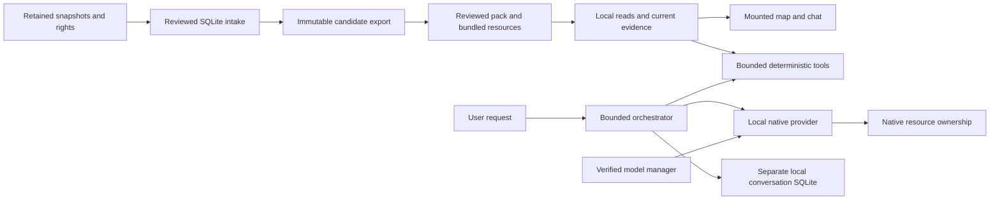

# Current architecture and quality gates

October 19, 2026 (Asia/Manila). This is the current host engineering guide, after
DEC-056–064 and the accepted U4 refinements. Original R1/M0–M9 and physical-device
reports remain historical records of their own source/APK. Host checks never
establish real-model correctness or physical acceptance.

## Working architecture



- `Application` composes initialization/navigation/pack owners and the mounted
  Map/Assistant pager. No new global state store, dependency injection framework
  or navigation framework is introduced.
- App domain owns exact centavos, price bounds and shared source preference
  policy. Feature compatibility exports preserve callers. Domain/geo/routing
  packages remain pure and independent of native storage/UI.
- SQLite content, user state, model index and conversation history have distinct
  owners. Content reads recheck current evidence; serial owners finalize
  statements and serialize lifetime/transactions. History stores bounded finalized
  display text/references, never executable proposals or temporary itineraries.
- Runtime composition serializes setup/activation/removal/initialization; close
  invalidates new operations, cancels current setup, drains lifecycle work, then
  closes history and releases the provider. Initialization rejection is retryable;
  poisoned native ownership is not bypassed. UI epochs and provider request epochs
  retain separate visibility/resource responsibilities.
- The model may propose bounded allowlisted tools. Host code validates identity,
  capability, arguments, authoritative price bounds and fresh evidence. Source
  content/model text cannot grant permissions. No saves, route generation,
  unrestricted loops or remote inference are enabled.
- Normal Models UI remains Download / Use / Remove, with no restored file-import
  control. U4 chat stays minimal; necessary uncertainty/stale/estimated limitations
  remain. No Sources/verification panels or removed product features are restored.

### Architectural checks and retained adapter seams

The AST dependency checker follows static imports, re-exports, import-equals,
literal dynamic imports and literal `require`, including native-module entrypoints.
It rejects cycles, unresolved/nonliteral imports and forbidden dependencies.
Type edges count conservatively toward cycles. Real font/image resources are
validated as resource paths, not mistaken for TypeScript modules.

Three existing adapter edges remain exact allowlisted seams, reported explicitly:
storage → office service (publish the already-reviewed projection); AI retrieval →
office service (operating-office eligibility / composition); AI retrieval → food
directory (compose the separately governed research service). These adapters are
not generalized exemptions. Type-only feature contracts remain usable by AI.
The orchestrator no longer imports feature-owned source policy. Splitting its
remaining bounded flow by line count would add interfaces without a demonstrated
behavioral benefit; resource/provider/dispatcher/answer ownership already exists.

## Data path and rights

`data/` is the authoritative host hub; generated app assets are build copies.
Raw source bytes, source-register entries, licenses and retained permission hashes
feed intake. Reviewed immutable bundles bind IDs, facts, parent relationships,
evidence and source versions. The exporter validates them again at an explicit
UTC instant, constructs separate mobile SQLite content and writes a checksummed
manifest in a temporary sibling directory before atomic activation.

The manifest records schema versions, source hashes/rights/evidence, accepted and
rejected counts and `publication_authorized=false`. Duplicate intake replay must
preserve IDs and output bytes; candidates never gain approval by being exported.
Mobile retrieval independently checks current lineage, branch/menu relationships,
exact amounts, source opt-outs and final actionable coordinates. Food/office
research and fictional demos stay separate from approved canonical authority.

SQLite structural integrity and foreign-key consistency are separate checks.
Damaged history is retained for recovery; map/data and session chat remain usable.
Atomic export interruption cannot replace an existing version. Migrations, IDs,
coordinates, source rights and current generated production bytes are unchanged.
PostgreSQL/PostGIS runtime, consolidation and export bridging are **DEFERRED**;
the existing portable schema/parser tests do not establish server execution.

## Reproduce checks

Use Python 3.13 / Node 22, `npm ci --prefix apps/mobile`, pinned Shapely 2.2.0,
pyproj 3.7.2, canonical parser requirements and `requirements-quality.txt`.
The latter contains only development tools (Ruff and PyYAML). Existing local
tool directories can be supplied through PYTHONPATH; no automatic path injection
or global installation is performed. CI and local runs use the same registry:

```powershell
python apps/mobile/scripts/quality.py --list
python apps/mobile/scripts/quality.py --output .g/quality-current
```

The runner records command, cwd, status, actual exit code, duration and log path;
results are checkpointed after each group. Missing files/executables, empty test
discovery, zero executed tests, unexpected skips, missing dependencies, nonzero
exits and a 300-second per-command deadline fail the gate. `--only NAME` can repeat
a group but its summary is explicitly `selected`, never full acceptance.

Historical GIS raw integration is a single named opt-in skip. Historical routing
can skip only its named unavailable private graph. Both appear in the machine
summary. Mandatory synthetic GIS/routing checks still run. No blanket skip or
optional-dependency success is allowed.

The portable lane includes AI/native-source/receipt regressions and office Python,
Node and lint checks. Android release/JVM and private APK verification are separate
host gates using the existing builder:

```powershell
python scripts/build-offline-ai-host.py --stage ai-host-quality-r2
```

That command requires the retained reviewed assets, pinned dependencies and cached
Android toolchain. It builds an isolated internal preview, runs native JVM tests
and verifies the APK/source receipt, map bytes, permissions, registration and
absence of bundled model weights. It never invokes ADB. Do not substitute a
successful portable report for this gate.

## Persistent development guidance and acceptance

Repository AGENTS.md requires the checked-in Ponytail core in full mode, audit for
repo investigations and review for changes. Provenance pins upstream, local and
original checksums and the one metadata compatibility adaptation. Instruction-only
installation adds no lifecycle hooks or machine-wide settings. The portable guard
checks file hashes and skill metadata; fresh Codex app-server discovery was tested
for both root/mobile scopes without starting a model turn or creating sidebar chats.
Future chats must be opened against this checkout (or a clone containing the files).

Every milestone handoff states evidence, failures, risks and parent review status.
New physical activity remains M10 under owner authorization. Reconcile the old
runbook with current U4/DEC-060–064 before execution; old import/save instructions
and old APK hashes do not define current behavior. No real-model quality,
native performance, GPU capability, accessibility or iOS acceptance is inferred.

Current results, limitations and retained evidence: [validation](VALIDATION.md).
Prioritized defects and review decisions: [findings](FINDINGS.md).
Daily record: [work journal](WORK_JOURNAL.md).
