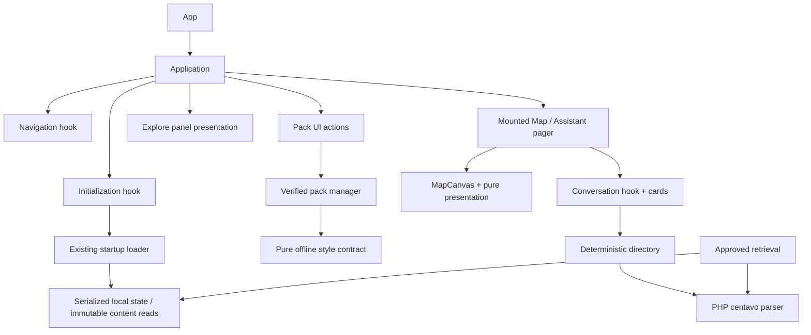

# R1 architecture and state ownership

No new runtime provider, DI registry, navigation framework or global state store. App installs the existing gesture/safe-area providers and mounts Application, which owns layout/composition and transient notifications. The pager keeps both screens mounted; features receive typed data and callbacks.

| State / responsibility | Owner | Preserved invariant |
|---|---|---|
| places, saved, savedAvailable, ready, startup, packStatus | useAppInitialization | Saved failure retains original saved object; stages/deduplication unchanged |
| boot epoch / store cleanup | initialization hook | Unmounted boot cannot publish; epoch guards closing |
| tab, panel, selected, query, category, returnPanel, keyboard | useExplorerNavigation | Keyboard wins Back; filter/source return and guards preserved |
| installing, confirming, packChecking, alerts | useContentPackActions | Confirmation, user initiation, errors and refresh ordering |
| active download controller | Application ref shared with hooks | Cleanup aborts latest active controller before eventual store cleanup |
| fonts, map display mode, insets, transient notices | Application | Loading UI, sheet calculations, 6500ms notice lifetime |
| messages, draft, busy, cancelled, timer, IDs, scroll intent | useDirectoryConversation | 160ms yield; latest records at resolution; mounted memory; timer cleanup |
| suggestions / timeline ref | AssistantScreen | Presentation-only expansion/scroll; suggestion preserves draft |
| resources, camera refs, AppState, reduced motion | MapCanvas | Native effects/dependencies unchanged; pure transforms extracted |
| connection ownership / saved transactions | data/store | Serialized lifetime, finalize/close, no caching or schema change |
| current fact eligibility | data/queries | Exact accepted SQL/date bindings/order, every-read recheck |
| activation / recovery / rollback | updates/index | Trust/hash/dependency/integrity/source gates, two-slot transactions |

Panel presentation receives the values needed by its seven existing cases and performs no SQLite or installation operations. Diagnostics retain the existing read-only health call and attribution link. No broad global application context is added.

Search remains policy-specific: Explore NFC with candidate/demo presentation; Assistant NFKC directory vocabulary and explicit capability messages; production bounded lexical alternatives and approved evidence. Only identical PHP centavo conversion is shared. Retrieval keeps its throwing wrapper; Assistant keeps null behavior and currency/evidence checks.

`updates/style-contract.ts` owns pure path/resource validation and URI resolution; `updates/style.ts` loads active native resources and retains compatibility exports. Manager and bundled loader import the pure contract, removing the cycle. Map presentation owns exact POI/display transforms; native camera/sensor owners stay intact.

Future AI can use approved retrieval independently of UI and add a reviewed request/lifecycle boundary. No provider, dispatcher or model manager is implemented. Timer cancellation does not establish inference cancellation. Persisted AI history, tool orchestration and memory/thermal/offline gates remain governed by DEC-052.
